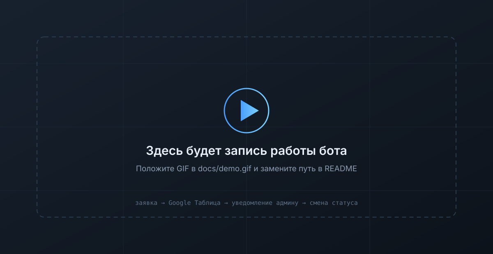

# 🤖 Telegram-бот приёма заявок с админ-панелью и Google Таблицами

**Заявки из Telegram — сразу в структурированную таблицу. Без менеджера-посредника и потерянных контактов.**

Продакшн-бот на **Python 3.11+** и **aiogram 3.x**: клиент проходит короткий диалог, заявка сохраняется в SQLite, мгновенно появляется строкой в Google Таблице, а администраторы получают уведомление с кнопками смены статуса.

---

## 💼 Бизнес-задача

Малый сервисный бизнес — веб-студия, автосервис, репетитор, агентство — теряет заявки между каналами. Клиент пишет в Telegram, менеджер забывает перенести контакт в таблицу, руководитель не видит воронку.

**Бот закрывает этот разрыв:**

| Было | Стало |
|---|---|
| Заявки в переписке и блокнотах | Одна структурированная таблица |
| Контакт теряется, клиент уходит | Заявка в БД, даже если Google недоступен |
| Руководитель не знает конверсию | Статистика по статусам в один экран |
| Клиент звонит «что с моей заявкой?» | Уведомление при каждой смене статуса |

Заявка не может потеряться: она сначала пишется в базу и только потом уходит в таблицу.

---

## 🎬 Демонстрация

<!--
  Пока записи нет, показывается заглушка docs/demo-placeholder.svg.
  Когда запишете демонстрацию: положите её в docs/demo.gif и замените путь ниже.
-->


| Куда посмотреть | Ссылка |
|---|---|
| 🤖 Живой тестовый бот | [`@ваш_тестовый_бот`](https://t.me/ваш_тестовый_бот) |
| 📊 Тестовая Google Таблица | [Открыть таблицу](https://docs.google.com/spreadsheets/d/ВАШ_ID_ТАБЛИЦЫ/edit) |

> **Замените обе ссылки на свои.** Строка бота — `https://t.me/<username>`, таблица — ссылка из адресной строки Google Sheets.
>
> Сценарий для проверки: `/start` → «Оставить заявку» → четыре шага → заявка появляется в таблице. Админка — `/admin`.

---

## ✨ Ключевые возможности

### Клиент

- 🚀 **Заявка за 4 шага** — услуга, имя, телефон, комментарий; экран подтверждения перед отправкой
- 👤 **Имя из профиля** — кнопка подставляет имя из Telegram, печатать не нужно
- 📞 **Телефон в один тап** — Reply-кнопка «Поделиться контактом» или ручной ввод с валидацией (`8 999…` → `+79991234567`)
- ⏭ **Комментарий необязателен** — кнопка «Пропустить»
- 📋 **Мои заявки** — статусы своих обращений без звонка менеджеру
- 💰 **Услуги и цены** — информационный экран с кнопкой оформления

### Администратор

- 📊 **Статистика** — пользователи, заявки за сегодня / 7 дней / всего, разбивка по статусам, состояние интеграции
- 🗂 **Лента заявок** — пагинация по 5, карточка заявки, смена статуса в один тап
- 🔔 **Уведомления о новых заявках** — всем админам, с кнопками статусов прямо в сообщении
- 📣 **Рассылка** — текст или фото с подписью, предпросмотр, подтверждение, отчёт о доставке
- 🔗 **Ссылка на таблицу** — из админки, без похода в конфиг

### Надёжность

- 🛡 **Заявка не теряется** — сначала SQLite, потом Google. При сбое API админ получает предупреждение с причиной, данные остаются в базе
- 🔄 **Синхронизация статусов** — обновляются база, нужная строка таблицы и клиент
- 🧭 **Защита от порчи таблицы** — перед записью статуса бот сверяет ID заявки, поэтому ручная сортировка листа не приведёт к записи в чужую строку
- 🕒 **Не блокирует event loop** — запросы к Google идут через `asyncio.to_thread` с таймаутом 30 с
- 🚫 **Глобальный обработчик ошибок** — клиент всегда получает ответ, а не «висящие часики»
- 📨 **Рассылка в фоне** — не тормозит заявки, помечает заблокировавших бота
- 🧪 **74 офлайн-проверки** — сценарии бота и слой таблиц тестируются без сети

---

## 🧰 Стек

| Слой | Технология |
|---|---|
| Язык | Python 3.11+ |
| Бот | aiogram 3.x — Router, FSM, middleware, CallbackData |
| База данных | SQLAlchemy 2.0 (async) + aiosqlite, SQLite с WAL |
| Google | Google Sheets API — gspread + google-auth, сервисный аккаунт |
| Конфигурация | pydantic-settings, переменные из `.env` |
| Деплой | Docker + docker compose, non-root пользователь |
| Тесты | Офлайн-сьюты на FakeBot и фейковом gspread |

---

## ⚡ Быстрый запуск в 3 команды

```bash
git clone <URL_РЕПОЗИТОРИЯ> && cd <ПАПКА_ПРОЕКТА>
python -m venv .venv && .venv/bin/pip install -r requirements.txt
cp .env.example .env && .venv/bin/python main.py
```

Windows (PowerShell):

```powershell
git clone <URL_РЕПОЗИТОРИЯ>; cd <ПАПКА_ПРОЕКТА>
python -m venv .venv; .venv\Scripts\pip install -r requirements.txt
Copy-Item .env.example .env; .venv\Scripts\python main.py
```

Перед третьей командой откройте `.env` и впишите две строки:

```dotenv
BOT_TOKEN=токен_от_@BotFather
ADMIN_IDS=ваш_telegram_id
```

Без `GOOGLE_*` бот тоже работает — просто без синхронизации с таблицей.

---

## 📖 Подробная инструкция

Пошаговый гайд со скриншотами шагов Google Cloud и разбором ошибок — в **[ЗАПУСК.md](ЗАПУСК.md)**.

---

## 🗂 Структура проекта

```
.
├── main.py                      # точка входа: polling, middleware, команды
├── bot/
│   ├── config.py                # настройки (pydantic-settings), разбор ссылки Google
│   ├── texts.py                 # ВСЕ тексты и подписи кнопок — правьте здесь
│   ├── utils.py                 # даты, телефоны, HTML-экранирование
│   ├── middlewares.py           # сессия БД, регистрация пользователя, конфиг
│   ├── filters.py               # IsAdmin
│   ├── database/
│   │   ├── models.py            # User, Order, статусы
│   │   ├── base.py              # движок, фабрика сессий, создание таблиц
│   │   └── repo.py              # все запросы к БД
│   ├── keyboards/
│   │   ├── callbacks.py         # CallbackData-фабрики
│   │   ├── user.py              # клиентские клавиатуры
│   │   └── admin.py             # клавиатуры админки
│   ├── states/forms.py          # OrderForm, BroadcastForm
│   ├── services/
│   │   ├── google_sheets.py     # gspread через asyncio.to_thread, таймауты, ошибки
│   │   └── orders.py            # сохранение заявки, смена статуса, уведомления
│   └── handlers/
│       ├── user.py              # клиентские сценарии
│       └── admin.py             # админ-панель
├── tests/
│   ├── offline_smoke_test.py    # сценарии бота без сети (FakeBot)
│   └── test_google_sheets.py    # слой таблиц на фейковом gspread
├── requirements.txt
├── Dockerfile
├── docker-compose.yml
├── .env.example
├── .gitignore                   # секреты и БД не попадают в git
├── .dockerignore                # .env/credentials.json не попадают в образ
├── ЗАПУСК.md                    # пошаговая инструкция по запуску
└── README.md
```

---

## ⚙️ Настройка Google Таблицы

### 1. Создайте таблицу

Откройте [Google Sheets](https://sheets.google.com) → создайте пустую таблицу. Шапку заполнять не нужно: бот создаст её сам при первом запуске:

| ID заявки | Дата и время | Telegram ID | Username | Имя | Телефон | Услуга | Комментарий | Статус |
|---|---|---|---|---|---|---|---|---|

Скопируйте ID из адресной строки и вставьте ссылку в `GOOGLE_SHEET_URL`.

### 2. Создайте сервисный аккаунт

1. Откройте [Google Cloud Console](https://console.cloud.google.com/) и создайте проект.
2. **APIs & Services → Library** — включите **Google Sheets API** и **Google Drive API**.
3. **APIs & Services → Credentials → Create credentials → Service account**:
   - имя, например `orders-bot`;
   - роль можно не назначать (доступ выдаётся на саму таблицу).
4. Откройте аккаунт → вкладка **Keys** → **Add key → Create new key** → **JSON**.
5. Переименуйте файл в `credentials.json` и положите **рядом с `main.py`**.

### 3. Дайте сервисному аккаунту доступ

В `credentials.json` найдите поле `client_email` (вид `orders-bot@project.iam.gserviceaccount.com`).

В Google Таблице: **Поделиться** → вставьте этот e-mail → роль **Редактор** → **Отправить**.

> Без этого шага заявки будут сохраняться только в БД, а админ получит предупреждение о сбое синхронизации.

---

## 🐳 Запуск через Docker

```bash
cp .env.example .env        # и заполните BOT_TOKEN / ADMIN_IDS
docker compose up -d --build
docker compose logs -f bot
```

Что учтено в `docker-compose.yml`:

- `.env` подключается через `env_file`;
- SQLite хранится в томе `./data` — данные переживают пересоздание контейнера;
- `credentials.json` монтируется только на чтение;
- ротация логов (10 МБ × 3 файла);
- `restart: unless-stopped`.

**Альтернатива файлу ключей** — переменная `GOOGLE_CREDENTIALS_JSON`: весь JSON одной строкой, удобно для CI/CD и облачных платформ.

> **Первый запуск без `credentials.json`.** Если файла нет, `docker compose up` остановится с ошибкой монтирования. Либо положите файл в корень проекта, либо уберите строку с `./credentials.json` из `volumes` и передайте ключ через `GOOGLE_CREDENTIALS_JSON`.

---

## 🧪 Проверка без Telegram и Google

Два офлайн-сьюта: сеть не нужна, Telegram и Google подменяются заглушками.

```bash
python tests/offline_smoke_test.py   # 43 проверки: меню, FSM, админка, сбои Google
python tests/test_google_sheets.py   # 31 проверка: шапка, строки, статусы, ошибки
```

Оба печатают список проверок и завершаются с кодом 1, если что-то сломалось.

```bash
python -m compileall -q .            # синтаксис всех файлов
```

---

## 🔧 Переменные окружения

| Переменная | Обязательна | По умолчанию | Описание |
|---|---|---|---|
| `BOT_TOKEN` | ✅ | — | Токен от @BotFather |
| `ADMIN_IDS` | ✅ | — | ID админов через запятую: `123,456` |
| `GOOGLE_SHEET_URL` | ➖ | — | Ссылка на таблицу (можно передать голый ID) |
| `GOOGLE_CREDENTIALS_PATH` | ➖ | `credentials.json` | Путь к JSON сервисного аккаунта |
| `GOOGLE_CREDENTIALS_JSON` | ➖ | — | JSON ключа строкой, приоритетнее путь |
| `GOOGLE_WORKSHEET_NAME` | ➖ | — | Имя листа; пусто → лист по `gid` или первый |
| `DATABASE_URL` | ➖ | `sqlite+aiosqlite:///data/bot.db` | Строка подключения |
| `TIMEZONE` | ➖ | `Europe/Moscow` | Часовой пояс для дат |
| `LOG_LEVEL` | ➖ | `INFO` | `DEBUG` / `INFO` / `WARNING` / `ERROR` |
| `ORDERS_PER_PAGE` | ➖ | `5` | Заявок на странице в админке (1–20) |
| `BROADCAST_DELAY` | ➖ | `0.05` | Пауза между сообщениями рассылки, сек |

Если `GOOGLE_*` не заполнены, бот полностью работает — просто без синхронизации с таблицей.

---

## 🏗 Как это устроено

### Поток заявки

```
Клиент                                  Бот                              Google / Telegram
  │  /start                               │                                    │
  │──────────────────────────────────────▶│                                    │
  │  «Оставить заявку»                    │                                    │
  │──────────────────────────────────────▶│ FSM: service → name → phone        │
  │  ...4 шага...                         │       → comment → confirm          │
  │  «Отправить»                          │                                    │
  │──────────────────────────────────────▶│ INSERT в SQLite (status=new)       │
  │                                       │──── append_row ───────────────────▶│ Google Sheets
  │                                       │──── send_message ─────────────────▶│ всем админам
  │                                       │◀─── нажатие статуса ───────────────│ админ
  │◀──── уведомление о статусе ───────────│ UPDATE БД + UPDATE I{row} ────────▶│ строка в таблице
```

### Обработка ошибок Google

| Ситуация | Поведение |
|---|---|
| Ключ не найден / битый JSON | Заявка в БД, админ получает `⚠️ Google Таблица не обновилась` с причиной |
| Нет доступа (`403`) | То же + подсказка «выдайте роль Редактор» |
| Таблица не найдена (`404`) | То же + подсказка проверить `GOOGLE_SHEET_URL` |
| Таймаут 30 с / квота `429` | То же, бот продолжает работать |
| Строка заявки удалена вручную | Строка дописывается заново |
| Лист отсортировали вручную | ID сверяется перед записью — статус не попадёт в чужую заявку |
| Клиент заблокировал бота | Помечается `is_blocked`, исключается из рассылок |

Все обращения к Google выполняются через `asyncio.to_thread`, поэтому бот не «зависает» на время сетевых вызовов.

---

## 🎨 Кастомизация под свой бизнес

- **Тексты, названия услуг, цены, подписи кнопок** — `bot/texts.py`. Ключи в словаре `SERVICES` менять нельзя (они пишутся в БД), а тексты — свободно.
- **Название компании** — `BRAND` в `bot/texts.py`.
- **Размер страницы в админке** — `ORDERS_PER_PAGE` в `.env`, допустимо 1–20.
- **Новые статусы** — добавьте в `ALL_STATUSES` (`bot/database/models.py`) и `STATUS_META` (`bot/texts.py`).

Бот универсален: пример с веб-студией меняется на автосервис или репетитора правкой одного файла текстов.

---

## ❓ Частые проблемы

**`TelegramUnauthorizedError`** — неверный `BOT_TOKEN`.

**`ZoneInfoNotFoundError: No time zone found with key Europe/Moscow`** — на Windows нужен пакет `tzdata` (есть в `requirements.txt`). В Docker ставится системно.

**`Нет доступа к таблице`** — сервисный аккаунт не добавлен в «Поделиться» либо выдана роль «Читатель».

**`Нет ID таблицы`** — в `GOOGLE_SHEET_URL` не ссылка. Формат: `https://docs.google.com/spreadsheets/d/<ID>/edit`.

**Админ не получает уведомления** — он должен хотя бы раз нажать **Start** у бота, иначе Telegram запрещает писать первым.

**Заявки есть в БД, но не в таблице** — проверьте `credentials.json`, доступ к таблице и что включены **Google Sheets API** и **Google Drive API**.

---

## 🔒 Безопасность

- Не коммитьте `.env` и `credentials.json` — они уже в `.gitignore`.
- Доступ к админке — только по `ADMIN_IDS` (фильтр `IsAdmin` на уровне роутера, включая `/admin`).
- Текст пользователя экранируется перед вставкой в HTML-сообщения.
- В Docker бот работает от непривилегированного пользователя `botuser`.
- `.dockerignore` не даёт секретам попасть в образ.

### Что попадает в git

| Исключается | Почему |
|---|---|
| `.env`, `.env.*` | Токен бота, ID админов, ссылка на таблицу |
| `credentials.json`, `*-credentials.json`, `service-account*.json` | Приватный ключ сервисного аккаунта |
| `data/`, `*.db`, `*.sqlite`, `*.sqlite3` (+ `-wal`, `-shm`, `-journal`) | Локальная база с заявками клиентов |
| `.venv/`, `venv/`, `__pycache__/`, `*.py[cod]` | Окружение и кэш байткода |
| `.vscode/`, `.idea/`, `*.log` | Настройки редактора и локальные логи |

`.env.example` намеренно **не** игнорируется — это шаблон без секретов. В нём стоят placeholders, которые заменяются уже в своём `.env`.

> **Проверка перед первым коммитом.** Выполните `git status` и убедитесь, что в списке нет `.env`, `credentials.json` и файлов из `data/`. Если секрет уже попал в историю — нужен новый токен и очистка истории.

> **Важно про монтирование ключа.** `docker-compose.yml` монтирует `./credentials.json` внутрь контейнера. Файл виден внутри, но не копируется в образ — путь должен существовать на хосте до запуска.
